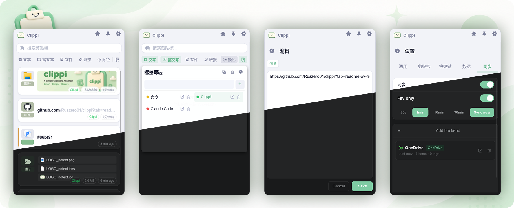

<div align="center">
  

  # Clippi

  **Simple · Lightweight · Open Source** native clipboard manager<br>
  Rust + GPUI · Windows / macOS

  <p>
    <a href="https://clippi.rains-ailurus.cn/"></a>
    <a href="https://clippi.rains-ailurus.cn/docs"></a>
    <a href="https://github.com/Ruszero01/clippi/releases"></a>
  </p>

  <p>
    
    
    
  </p>

  <a href="README.md">中文</a> · <strong>English</strong>
</div>



## Features

- **Capture & organize**: save text, rich text, images, files, and more. Search, tag, favorite, annotate, and manage entries in batches.
- **Quick paste**: summon Clippi with a global hotkey; the quick window preserves your typing focus. Hold Alt to see and use switching shortcuts.
- **Content recognition**: extract text with image OCR and recognize QR codes.
- **Cross-device sync**: sync text entries and tags through OneDrive, iCloud folders, or WebDAV, with multiple backends supported.
- **Everyday tools**: an entry editor, emoji and symbol panel, and file transfer station.
- **Appearance & privacy**: light/dark themes, custom fonts and accent colors, masked previews, and local backup and restore.

## Download & use

Download from the [website](https://clippi.rains-ailurus.cn/) or [GitHub Releases](https://github.com/Ruszero01/clippi/releases). Press `Alt+V` to open the main window by default. See the [user guide](https://clippi.rains-ailurus.cn/docs) for details.

- **macOS**: the app is unsigned. Allow it in **System Settings → Privacy & Security** after installation or updates, and grant **Accessibility** permission for quick paste.
- **Windows**: to paste into elevated applications, Clippi must also run as administrator. Change administrator mode in **Settings → Main → Startup**, then restart Clippi.

## Run from source

Install [Rust](https://www.rust-lang.org/tools/install) and your platform's build tools, then run:

```bash
git clone https://github.com/Ruszero01/clippi.git
cd clippi
cargo run --release
```

## Contributor wall

Thanks to everyone who contributes!

<a href="https://github.com/Ruszero01/clippi/graphs/contributors">
  <picture>
    <source media="(prefers-color-scheme: dark)" srcset="docs/images/contributors-dark.svg">
    
  </picture>
</a>

<p align="center">
  <a href="https://github.com/Ruszero01/clippi/issues"></a>
  <a href="RELEASES.md"></a>
  <a href="LICENSE"></a>
</p>
